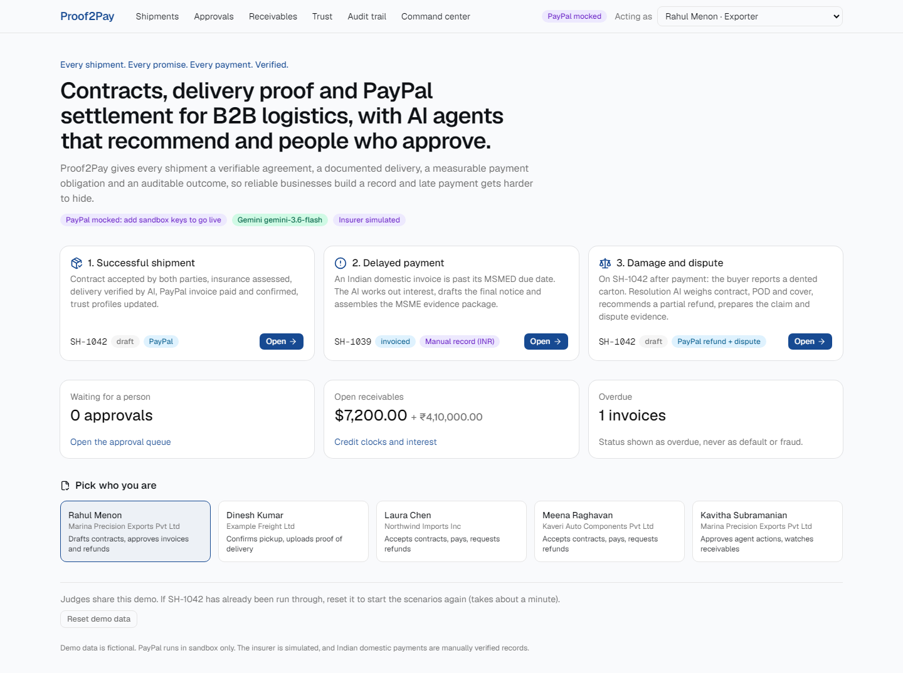
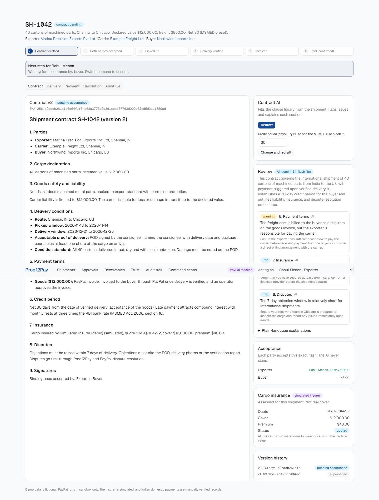
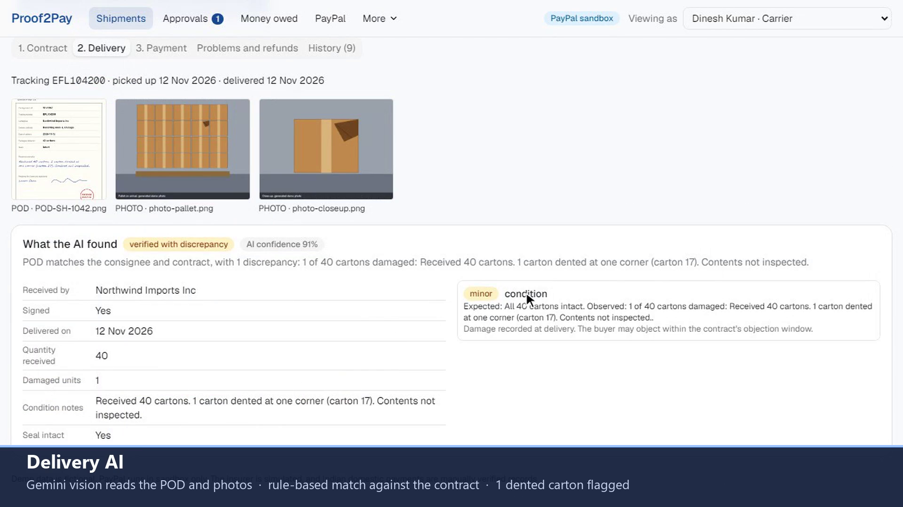
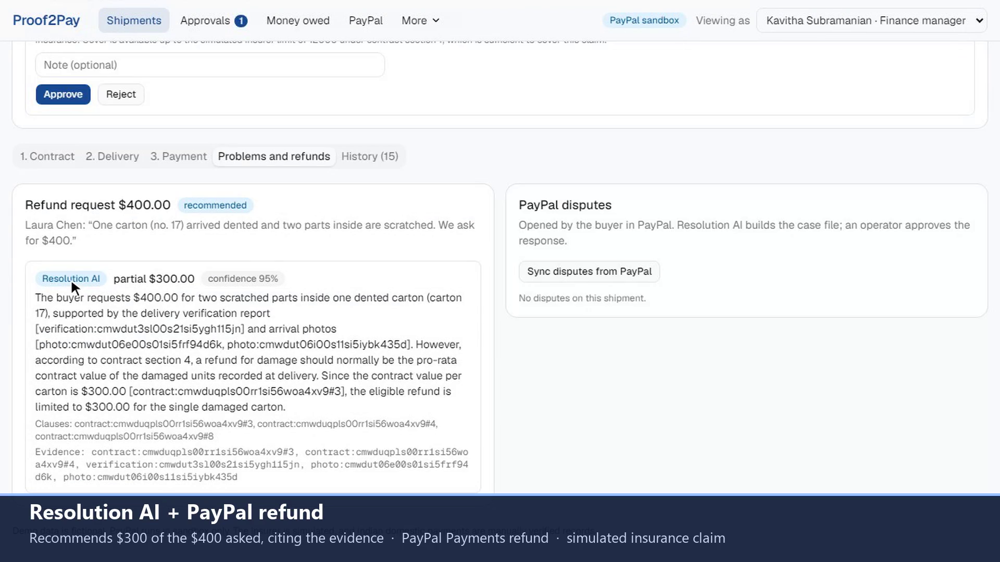
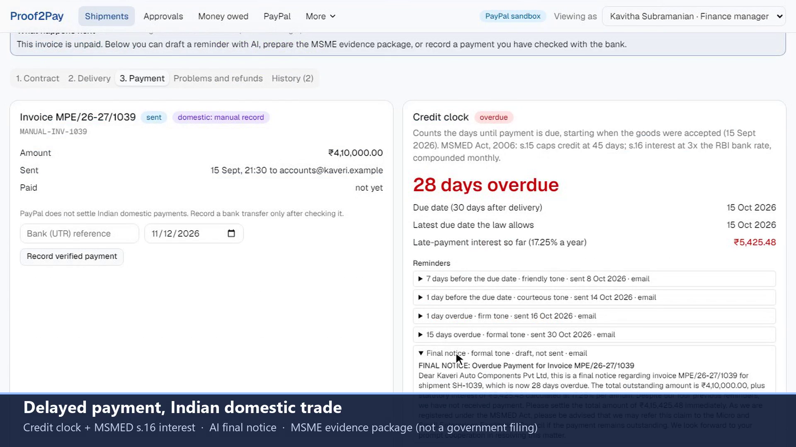
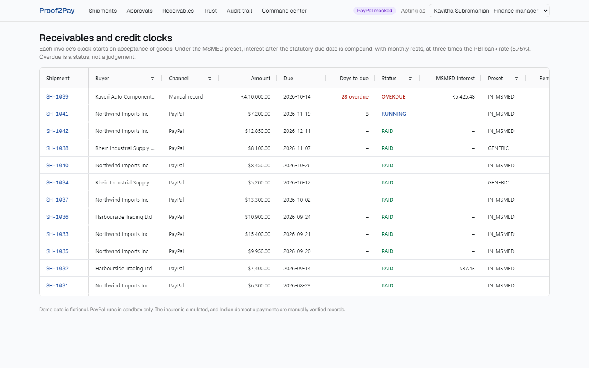
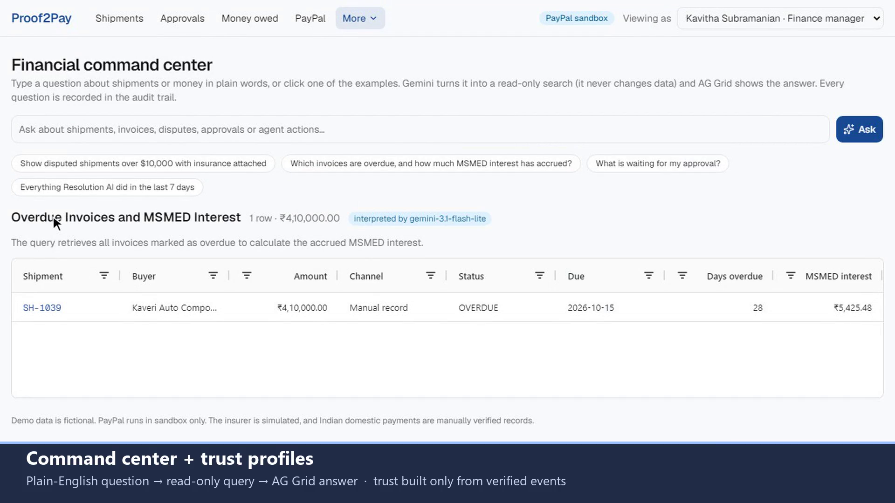
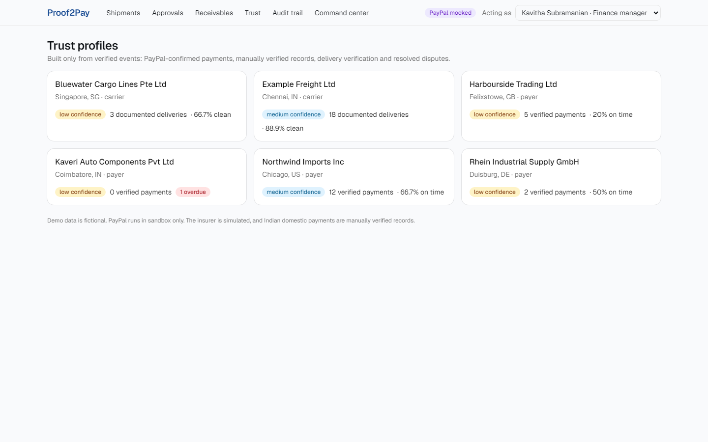

# Proof2Pay

**Every shipment. Every promise. Every payment. Verified.**

Proof2Pay is a contract, delivery, payment and trust platform for B2B logistics. Every shipment gets a verifiable agreement, a documented delivery, a measurable payment obligation and an auditable outcome. AI agents recommend, people approve, and PayPal settles.

Built for the PayPal AI Hackathon 2026. MIT licensed.

- **Live demo:** https://proof2pay-3frl.onrender.com (pick a story on the home page; no login)
- **Video:** `<YouTube link>`



## The problem

MSMEs and logistics companies carry the cost of late payment, weak paperwork and customers they cannot assess. Freight is shipped on an email thread, delivery is hard to prove against the agreement, and refunds and disputes mean collecting documents by hand. In India alone, micro and small enterprises have more than ₹22,000 crore stuck in delayed-payment claims on the MSME Samadhaan portal.

## Three scenarios

| Scenario | What happens | PayPal |
|---|---|---|
| **1. Successful shipment** (SH-1042) | Contract AI drafts and flags the contract; the MSMED rule blocks illegal credit terms; exporter and buyer accept the same SHA-256 hash; the carrier uploads the POD; Delivery AI reads it with Gemini vision; Payment AI proposes the invoice; an operator approves; the buyer pays; trust profiles update | Invoicing v2 create, send and get; verified webhook; Add Tracking on the payment |
| **2. Delayed payment** (SH-1039) | An Indian domestic invoice 28 days overdue: the credit clock computes MSMED s.16 interest; Payment AI drafts the final notice and assembles an MSME evidence package ("not a government filing") | Not on PayPal: PayPal does not settle Indian domestic payments, so payment is a manually verified record |
| **3. Damage and dispute** (SH-1042) | The buyer asks for $400 for a dented carton; Resolution AI recommends $300 (pro-rata contract value) with cited evidence; an operator approves the refund, a simulated insurance claim and the dispute response | Payments v2 refund; Disputes v1 list, get, provide-evidence (else send-message) |

| Contract AI | Delivery AI |
|---|---|
|  |  |
| **Resolution AI** | **Delayed payment** |
|  |  |

## The agents, and where a person decides

| Agent | Job | Person approves |
|---|---|---|
| Contract AI | Fills a fixed, human-written clause library from the shipment; flags issues; explains each section in plain language. Rule flags (MSMED s.15 cap) block acceptance | Both parties accept the hash. The AI never signs |
| Delivery AI | Gemini vision extracts consignee, signature, date, count and damage from the POD and photos; deterministic rules compare them with the contract | Nothing: discrepancies go to Resolution AI |
| Payment AI | Proposes the invoice (due = acceptance + credit days), runs the credit clock, drafts escalating reminders, builds the MSME package | Every invoice before it is sent |
| Resolution AI | Weighs refund requests and disputes against the contract, POD and cover; finds contradictions and missing evidence; builds the dispute evidence pack | Every refund, insurance claim and dispute response |
| Trust AI | Payer and carrier profiles from verified events only, with confidence bands | Corrections and appeals |
| Command center | Turns a manager's question into a read-only query spec; AG Grid shows the result | — |

**What the AI never does:**
- sign, refund, pay, buy insurance or file a claim without a person
- mark an invoice paid without PayPal's record, or a verified manual record for domestic trade
- claim cover exists without a policy
- call a business fraudulent
- invent verification results or legal deadlines
- promise an outcome

Every agent action, operator decision and webhook is written to the audit trail, with its reasoning, the model used and the evidence it relied on.

| Receivables (AG Grid) | Command center (AG Grid) |
|---|---|
|  |  |

## PayPal integration

All calls go to the sandbox. The code is in [lib/paypal/api.ts](lib/paypal/api.ts).

| API | Used for | Code |
|---|---|---|
| OAuth 2.0 client credentials | Token, cached until near expiry | `lib/paypal/client.ts` |
| Invoicing v2: create (`Prefer: return=representation`), send, get, remind | Goods and freight invoice after verified delivery and operator approval; payer link; reminders | `createAndSendInvoice`, `getInvoice`, `remindInvoice` |
| Payments v2: refund capture | Approved partial refund on the invoice's payment transaction | `refundCapture` |
| Shipment Tracking: trackers-batch | Carrier tracking (DELIVERED) attached to the PayPal transaction once paid | `addTracker` |
| Disputes v1: list, get, provide-evidence, send-message | Sync disputes, match them to shipments, send the approved response | `listDisputes`, `getDispute`, `respondToDispute` |
| Webhooks: verify-webhook-signature, create | `INVOICING.INVOICE.PAID`, `CUSTOMER.DISPUTE.*`, `PAYMENT.CAPTURE.REFUNDED`. Signatures are verified, then the invoice is re-read before it is marked paid | `app/api/paypal/webhooks/route.ts`, `npm run paypal:setup` |

Without sandbox keys the app runs with PayPal mocked, and every mocked record shows a "PayPal mocked" label.

## Architecture

A single Next.js 15 application (a modular monolith) on a Render free web service, with Prisma 7 on Neon Postgres (free tier).

```
Browser: personas, shipment workspace, approvals, receivables, audit trail, command center
   │  server actions
Agents (lib/agents): contract · delivery · payment · resolution · trust · command
   │ propose ─▶ ApprovalRequest ─▶ operator ─▶ execute
   ├─ Gemini (lib/llm.ts): zod-validated JSON; model chain; labelled sample fallback
   ├─ PayPal REST (lib/paypal): invoicing, refunds, tracking, disputes, webhooks
   ├─ Rules: credit clock (MSMED), delivery matching, trust metrics, simulated insurer
   └─ AuditEvent for every step ─▶ Postgres (Neon)
PayPal webhooks ─▶ /api/paypal/webhooks (verify, store, re-read, reconcile)
```

Decisions with legal or financial weight come from unit-tested deterministic code in `lib/credit-clock`, `lib/agents/delivery-match.ts`, `lib/trust-score` and `lib/insurer-sim`. The model extracts, explains, drafts and recommends.

## Trust and fairness

- **Verified events only:** profiles change only on payments confirmed by PayPal or recorded after a bank check, delivery verification reports, and resolved disputes. Users cannot post allegations.
- **Distinct statuses:** overdue, disputed, under review and resolved are reported as such, and never as default or fraud.
- **Confidence bands:** a business with fewer than 10 verified events is shown as low confidence.
- **Corrections:** both parties can respond, and corrections and appeals go to a person.



## Credit clock and the MSMED preset

The clock starts on acceptance of goods, which is the verified delivery date. Under the `IN_MSMED` preset (Micro, Small and Medium Enterprises Development Act, 2006):

- Section 15 caps a written credit period at 45 days, and sets 15 days when none is written.
- Section 16 charges compound interest with monthly rests at three times the RBI bank rate (5.75%, checked 2026-11-02; set with `RBI_BANK_RATE_PCT`).

Evidence packages are prepared for the MSE Facilitation Council (MSME Samadhaan or ODR). They are documentation; Proof2Pay files nothing.

## Run locally

Prerequisites: Node.js 22+ and a PostgreSQL 15+ database. Either Docker (`npm run db:up` starts one on port 5433) or a free Neon project.

```bash
npm install                # also generates the Prisma client
cp .env.example .env       # add GEMINI_API_KEY (free at aistudio.google.com); PayPal keys optional
npm run db:up              # local Postgres 17 (skip if you use Neon)
npm run db:deploy          # apply migrations
npm run db:seed            # wipe and load demo data (requires DEMO_MODE=true)
npm run dev                # http://localhost:3000
```

**PayPal sandbox (optional):**
1. Create an app at developer.paypal.com and put `PAYPAL_CLIENT_ID` and `PAYPAL_CLIENT_SECRET` in `.env`.
2. Set `PAYPAL_SANDBOX_BUYER_EMAIL` to your sandbox Personal account. Invoices go there.
3. Run `npm run paypal:setup` to check the keys.
4. Once deployed, run `npm run paypal:setup -- https://your-app.onrender.com` to register the webhook, then set the `PAYPAL_WEBHOOK_ID` it prints.

**Checks:**
- `npm test` runs 40 unit tests.
- `npm run typecheck` and `npm run lint`.
- `npm run e2e -- pod.png [photo.png]` drives all three scenarios through the agents without a browser (reseed afterwards).

If your router refuses DNS for `*.neon.tech`, prefix local commands with `NODE_OPTIONS="--require=./scripts/public-dns.cjs"`.

## Deploy (free)

[](https://render.com/deploy?repo=https://github.com/arungeekay/proof2pay)

- **App:** Render free web service, defined in [render.yaml](render.yaml). The build migrates the database and seeds it only if it is empty.
- **Database:** Neon free Postgres. Use the pooled string as `DATABASE_URL` and the direct string as `DATABASE_URL_UNPOOLED`.
- **Keep-alive:** set the repository variable `APP_URL`, and [keepalive.yml](.github/workflows/keepalive.yml) pings `/api/ping` every 10 minutes.
- **Resetting the demo:** the home page has a "Reset demo data" button (DEMO_MODE only).

## Honest limits

- PayPal India handles cross-border payments only. Domestic Indian trade keeps the contract, delivery proof, credit clock and evidence, with payment as a manually verified record.
- The cargo insurer is simulated and labelled as such everywhere. It is never real cover.
- GST and Udyam verification and government filing are not connected. Business identity is shown as not independently verified.
- Sandbox disputes are hard to open on demand, so DEMO_MODE offers a replayed dispute, labelled as such.
- On Gemini's free tier, an overloaded or exhausted model is skipped. If every model fails, the app shows labelled sample output instead of inventing silently.

## License

[MIT](LICENSE)
